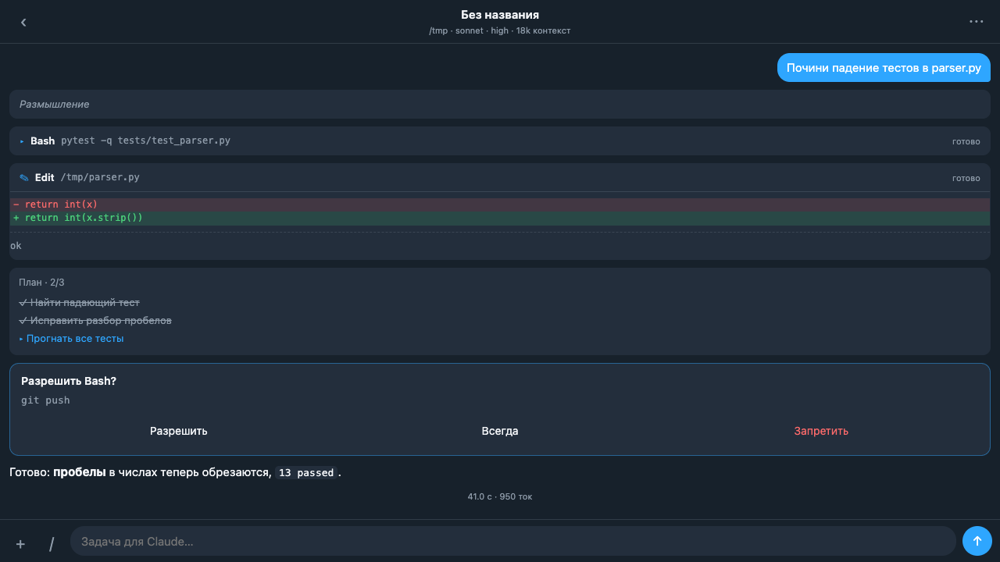

# Claude Pocket — Claude Code в Telegram Mini App

Мобильный интерфейс к Claude Code: открывается кнопкой в личке Telegram-бота и заменяет расширение
VS Code на телефоне. Агент работает на сервере в папке проекта, а телефон показывает поток его работы:
текст, размышления, вызовы инструментов, diff правок, план, запросы разрешений.



## Что умеет

- Чаты с потоковым ответом и карточками инструментов, блок размышлений, «Стоп».
- Журнал на сервере: можно закрыть Telegram посреди прогона, вернуться и дочитать всё, что произошло без тебя.
- Модель (opus / sonnet / haiku) и глубина размышления на лету, ветка чата (fork), архив, удаление.
- Четыре режима разрешений; запрос «Разрешить / Всегда / Запретить» приходит в приложение и пушем в Telegram —
  ответить можно кнопкой прямо в чате бота.
- Браузер файлов проекта с отправкой файла в Telegram, загрузка файлов и картинок с телефона в задачу.
- Панель команд (`/context`, `/compact`, `/clear`, `/usage`, `/recap`), список скиллов, план-режим, todo-панель.
- Бот-мост: текст или файл, присланный боту, уходит задачей в выбранный чат.

## Как устроено

```
Telegram ── Mini App (frontend/, ванильный JS) ──HTTPS──► nginx ──► FastAPI (backend/app.py, 1 воркер)
                │                                                     │
                └── пуши и кнопки ◄── bridge/bridge.py ◄── service-token ┤
                                                                      ├─ sessions.py: ClaudeSDKClient на чат
                                                                      └─ journal.py: SQLite, события с seq
```

- **Вход** — только Telegram `initData`: подпись HMAC-SHA256 проверяется на сервере (`tg_auth.py`),
  пускается единственный владелец (`OWNER_ID`), дальше — JWT. `initDataUnsafe` с клиента не используется.
- **Движок** — Claude Agent SDK поверх подписочного токена Claude Code, а не `claude -p`: SDK даёт потоковый текст,
  карточки инструментов, `interrupt`, `resume`, `fork_session`, запросы разрешений (`can_use_tool`) и слэш-команды.
- **Журнал — источник правды.** Каждое событие получает порядковый номер `seq`; поток идёт NDJSON по одному
  событию в строке (`/chats/{id}/stream?after=<seq>`), фронт переподключается сам и добирает пропущенное.
- **Живые сессии в памяти процесса** — поэтому воркер строго один. Каждая сессия ≈ 250 МБ, активных не больше
  `MAX_ACTIVE_SESSIONS`, простаивающие выгружаются через 10 минут и продолжаются по `resume` без потери контекста.
- **Плановый режим** CLI сбрасывается после первого ответа, поэтому режим разрешений выставляется перед каждым ходом.
- Рестарт сервиса обрывает текущий прогон: чат честно помечается плашкой и продолжается со следующего сообщения.

## Запуск

```sh
cd backend && python3 -m venv ../venv && ../venv/bin/pip install -r requirements.txt
cp ../deploy/pocket.env.example /opt/claude-pocket/pocket.env   # BOT_TOKEN, OWNER_ID, путь к токену Claude
../venv/bin/uvicorn app:app --host 127.0.0.1 --port 8030 --workers 1
```

Фронтенд — статика из `frontend/` за nginx (`deploy/nginx.conf`), бот-мост и бэкенд — systemd-юниты из `deploy/`.
В BotFather боту ставится кнопка меню с адресом Mini App.

Локальный стенд без телефона: `BOT_TOKEN=123:dev OWNER_ID=1 python tests/dev_server.py` → `http://127.0.0.1:8031/code/`
(сервер сам подписывает `initData` и подставляет заглушку `Telegram.WebApp`).

## Тесты

```sh
pip install fastapi httpx pyjwt python-multipart pytest
pytest -q tests/test_api.py
```

Проверяются вход по `initData` (владелец, чужой пользователь, поддельная подпись), JWT и жизненный цикл чата
в журнале. Живая модель в тестах не запускается.

## Стек

Python 3.12, FastAPI, Claude Agent SDK, SQLite (WAL), JWT; фронтенд — HTML/CSS/JS без сборки, Telegram WebApp API;
nginx, systemd.

## Лицензия

MIT — см. `LICENSE`.
